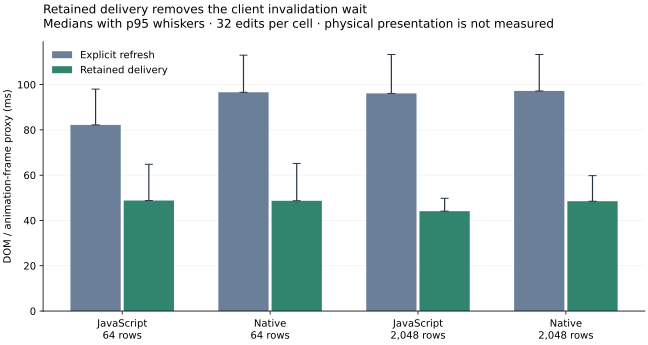

# Retained query delivery: comparison with explicit refresh

The Tables app and connected dashboard now subscribe to one retained exported query and receive ordered view patches. The live path delivers computed updates without the fallback client's 32 ms invalidation delay. Its cursor and bounded replay history handle reconnects, duplicates and snapshot recovery; pending event acknowledgements remain a separate ordered lane.

[Delivery and version contract](../retained-queries.md) · [Refresh measurements](retained-query-refresh-2026-11-04.json) · [Live measurements](retained-query-live-2026-11-04.json)

## Observed latency

Same Apple M4 Pro, macOS arm64, Node 24.22.2 and headless Chrome as the previous study. Every cell has a fresh Node/browser process, two panes, 20-row pages, 32 serial edits, selected maintained-fold code and durable collaboration storage. Native cells execute actual compiled Rust. Both reports identify clean runtime revision `40eb81816ca588f21b99618f474307c3258e85cc`; subsequent correctness fixes cover adopting an already in-flight read and recovering a transient query error, rather than changing the measured steady-state scheduling path.

| Target / rows | Refresh median / p95 | Retained median / p95 |
| --- | ---: | ---: |
| JavaScript / 64 | 82.2 / 98.0 ms | 48.8 / 64.8 ms |
| Native / 64 | 96.6 / 113.0 ms | 48.7 / 65.2 ms |
| JavaScript / 2,048 | 96.1 / 113.3 ms | 44.1 / 49.8 ms |
| Native / 2,048 | 97.2 / 113.3 ms | 48.5 / 59.8 ms |



These are the existing **DOM/animation-frame proxy**, not physical presentation times. They are exploratory single-host observations, not repeated statistical evidence or a target-selection profitability proof. Fsync variability, frame quantization and process scheduling explain part of the differences between cells; the mechanism change removes a known 32 ms client coalescing wait. The non-monotonic row-size results do not mean larger tables are intrinsically faster.

## Execution and bytes

Every measured cell, in both modes, executed exactly:

- 32 writes and 32 exported `dashboard` evaluations.
- 64 affected `results` component computations: one per pane per edit.
- Refresh mode: 64 refresh replies. Retained mode: 64 watch deliveries and **zero refresh RPCs**.

The earlier cache already shared one query evaluation between the two panes. This change gives that result a retained lifetime, commit-driven maintenance and ordered delivery; it does not claim a further reduction in query evaluations for these spaced serial edits. Burst tests separately verify safe coalescing while source versions remain ordered. An initial implementation rendered each pane twice during the query's update; checked component dependencies now defer input-backed computation until its result is ready.

| Target / rows | Refresh RPC body bytes/edit | Retained RPC body bytes/edit |
| --- | ---: | ---: |
| JavaScript / 64 | 14,535 | 14,650 |
| Native / 64 | 14,532 | 14,646 |
| JavaScript / 2,048 | 14,570 | 14,684 |
| Native / 2,048 | 14,566 | 14,680 |

Watch cursor fields add roughly 115 bytes/edit, about **0.8%**. Both paths include source-version metadata. Verbose write replies still dominate the body totals; removing their repeated entry descriptors is separate work. Live accounting pairs requests with responses completed in the measurement window, including already-outstanding watch requests and excluding the next pending request. Headers, SSE bodies, initial assets, production authentication, desktop MessagePort transport and physical presentation remain outside the comparison.

All eight cells passed conflict, aborted-change, duplicate/lost-write-reply and exact recovered-wire checks, with no recorded UI errors. Recovery replays collaboration records and restarts execution services/native processes; compiler caches remain in the Node coordinator, so this is not a cold whole-host restart benchmark.

## Remaining storage boundary

The selected checked plan maintains aggregate keeps. The retained page still comes from evaluating the checked Ink query and then deriving a positional splice; it does not yet avoid materializing the filtered table. The original application and collaboration checkpoint costs are unchanged. Retention and delivery therefore improve responsiveness and protocol ownership without completing storage-level incremental query planning.

Reproduce with the configured Node/Rust toolchains and an existing Chrome/Chromium:

```sh
export INK_UI_BROWSER_EXECUTABLE=/path/to/chrome
node scripts/benchmark-ink-system.mjs --rows 64,2048 --modes javascript,native \
  --edits 32 --output work/refresh.json
node scripts/benchmark-ink-system.mjs --live --rows 64,2048 --modes javascript,native \
  --edits 32 --output work/live.json
# Explicit Python environment with matplotlib/NumPy, for the standalone figure:
python scripts/plot-retained-query.py work/refresh.json work/live.json work/retained.svg
```
