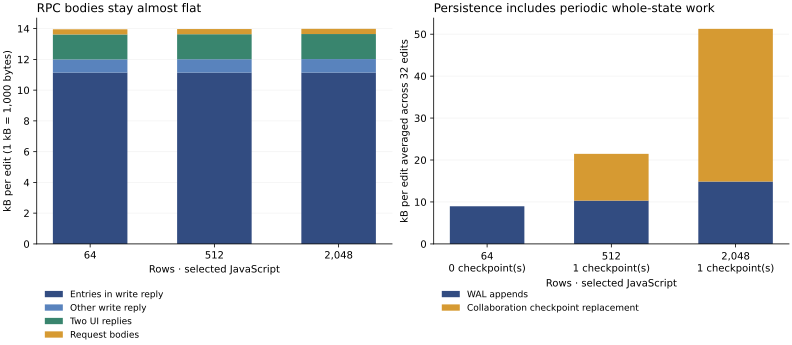
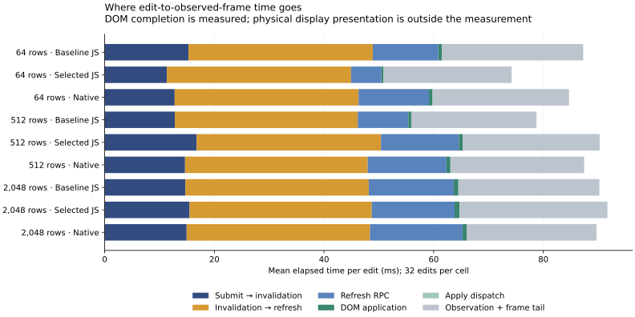

# Ink Tables: where the milliseconds and bytes go

Measured 4 November 2026 on an Apple M4 Pro, macOS arm64, Node 24.22.2, using an existing headless Chrome. The measured runtime revision is `df4f03326d2e929090db8e7ae565131d394ab83c`; the report records a clean tracked tree and exact compiler/system identities. Each of nine cells runs in a fresh Node/browser process: 64, 512 or 2,048 open rows; baseline JavaScript, selected JavaScript or actual native computation; 32 serial edits of row 1; two apps each showing a 20-row page. Source, input, output and runtime limits are unchanged.

[Raw nested spans and byte accounting (gzip JSON)](tables-profile-2026-11-04.json.gz) · [Computed summary](tables-profile-2026-11-04.summary.json) · [64-row selected-JS Chrome trace](tables-profile-2026-11-04.trace.json) · [Tracing-disabled controls](tables-profile-control-2026-11-04.json)

## Most of the RPC bytes are descriptors

At 64 rows with selected JavaScript, each edit makes one write request and two view refresh requests. The means below include exact UTF-8 JSON keys, values and punctuation; each request/response and the complete measurement window must reconcile before the benchmark succeeds.

| Body content | Mean bytes per edit |
| --- | ---: |
| Entry descriptors in write reply | 11,139.0 |
| Other write reply fields | 859.7 |
| Two UI patch replies | 1,622.3 |
| Three request bodies | 335.8 |
| **Total** | **13,956.8** |

`Code.execute` returns `entries: compiled.entries` for every invocation. `runInstalledInk` retains those descriptors in the response along with output/wire/value/valueWire, source identities and release metadata. The fixed descriptors account for **79.8% of all RPC body bytes**. The UI sends two keyed operations per pane, usually updating the changed item's text and the aggregate label; it does not transmit the entire table. RPC bytes stay near 14 kB at all three table sizes.

The write's `wire` field costs 149 bytes including JSON framing, and its public `output` costs 128 bytes. Those are much smaller than `entries`. The summary retains every individual top-level field, including the 266-byte source-identity field and duplicate scalar result representations. A future compact execution reply should preserve exact results, versions, events, retry semantics and release fences while moving static descriptors to discovery/admission; changing that API is outside this measurement change.

The instrumented fixture also sends a mean 45.7 bytes of SSE body framing per edit at 64 rows. Those diagnostic notifications carry a causal trace ID. They are reported separately from RPC bodies. HTTP headers, TCP framing, TLS, assets and initial mounting are outside these body totals; this is loopback HTTP, not a WAN bandwidth measurement.



## The browser path is dominated by waiting

The browser milestones partition every individual edit exactly. These **means** for 64-row selected JavaScript add to 74.22 ms; a median does not decompose additively.

| Critical-path interval | Mean ms |
| --- | ---: |
| Submit to browser receiving durable invalidation | 11.341 |
| Invalidation to the slower pane's refresh starting | 33.594 |
| That pane's complete refresh RPC | 5.503 |
| Dispatch between decoded reply and DOM application | 0.003 |
| Apply the final pane's DOM patch | 0.372 |
| Polling observation and additional animation-frame wait | 23.403 |
| **Total** | **74.216** |

The UI runtime explicitly coalesces invalidations for **32 ms** before reading. The benchmark then polls the DOM on animation frames and waits another frame after it observes both updated panes. That observation tail is benchmark overhead, not time spent computing or applying the application view. The DOM actually finishes at a median 49.3 ms here, while the legacy frame-proxy median is 66.0 ms. The old `editToPaint` JSON name is retained for compatibility; **neither an animation-frame callback nor this benchmark measures physical presentation or compositor paint**.

The host's WAL `fsync` calls average 8.63 ms per edit in this cell. That is already inside the submit/invalidation interval, not an additional 8.63 ms to add to the table. The two refreshes overlap. Nested host spans and concurrent work must likewise not be summed as critical-path elapsed time.

The actual exported query executes once per measured edit; both panes share it. JavaScript worker query computation averages 0.124 ms, versus a 0.512 ms resident round trip including codecs, message movement and scheduling. The UI component workers also perform checked argument preparation, decoding, computation and exact result encoding; the summary lists each phase by entry. The query snapshot spans include consumers waiting for the same in-flight result.

Server HTTP JSON encoding averages 0.047 ms per edit across the three replies. Client/server residuals average 1.04 ms for the write and 1.68 ms per refresh: these include dispatch, HTTP/body transfer and browser scheduling, and are not pure network latency. Server self time remains visible as exclusive spans; uninstrumented host work and event-loop delays are not relabelled as computation.



## Larger tables expose persistence and query costs

All numbers below are from the traced matrix. These are exploratory single-host runs, not repeated statistical evidence of target superiority.

| Rows | Baseline JS DOM / frame median | Selected JS DOM / frame median | Native DOM / frame median |
| --- | ---: | ---: | ---: |
| 64 | 62.3 / 82.3 ms | 49.3 / 66.0 ms | 60.2 / 82.3 ms |
| 512 | 53.2 / 81.8 ms | 66.6 / 94.4 ms | 64.4 / 82.5 ms |
| 2,048 | 65.1 / 82.7 ms | 65.7 / 97.4 ms | 66.6 / 93.9 ms |

Frame quantization, fsync variability and run-to-run scheduling are substantial; the non-monotonic medians are not an automatic profitability signal. At 2,048 rows, selected JavaScript query computation averages 0.610 ms against baseline's 1.469 ms, but that saving does not establish an end-to-end improvement. Filtering still materializes table values before slicing. Native query round trips average 2.263 ms there; native spans include IPC and codecs, so this is not an isolated native-kernel timing.

| Selected JS workload | WAL bytes/edit, observed mean | Collaboration checkpoint replacement | WAL bytes on application checkpoint edit | Maximum frame-proxy latency |
| --- | ---: | ---: | ---: | ---: |
| 64 rows | 8,977 | None in this window | 71,702 | 88.5 ms |
| 512 rows | 10,318 | 356,861 bytes | 113,940 | 114.7 ms |
| 2,048 rows | 14,870 | 1,164,809 bytes | 259,227 | 147.0 ms |

Each cell includes one application checkpoint, on edit 32. Application compaction stages a complete base snapshot plus retained retry receipts, publishes a new header and collects old payload chunks. The collaboration layer separately checkpoints its complete replica at its existing cursor interval. Its 512-row checkpoint contains 562 registers, including 533 tombstones; at 2,048 rows it contains 2,322 registers, including 2,282 tombstones. These snapshots retain causal metadata as well as live state.

Checkpoint phases differ: there is no collaboration checkpoint in the 64-row window, one on edit 25 at 512 rows, and one coincident with the application checkpoint on edit 32 at 2,048 rows. Thus the graph shows **observed bytes divided by 32 edits**, not a phase-normalized long-run storage rate. At 2,048 rows the two checkpoint layers together write about **1.42 MB for that one edit**, excluding filesystem metadata, directory writes and World checkpoint replacement. This is payload-byte accounting, not physical-device write amplification.

Even ordinary app-header publication grows across the cycle: at 64 rows the first edit appends 2,631 bytes, edit 16 appends 6,955, and edit 31 appends 11,275. The header republishes its growing list of transaction descriptors. The earlier 16-edit benchmark's roughly 4.8 kB/edit covered the first half of that cycle and excluded collaboration checkpoint replacement. It should not be treated as a complete durability cost.

## Instrumentation, controls and reproduction

`--trace` enables benchmark-only method observers with async request context, bounded span storage and private JS worker telemetry. UI `onTrace` is optional; observer exceptions are isolated. No trace fields enter Ink values, receipts or checkpoints. Closing the profiler restores original methods and disables worker telemetry. No public diagnostic endpoint or API scope is added.

Each raw sample contains the browser intervals and nested host spans for state-lane queueing, execution, resident requests, shared queries, view composition/diff, journal staging/collection, replica application, WAL writes/fsync, collaboration checkpoints, HTTP encoding and invalidation delivery. JavaScript worker phases separately measure checked input preparation, decoding, compute and result encoding. Native execution retains its existing protocol and reports its complete resident round trip. Clock alignment uses nine loopback probes and the minimum round trip; the selected uncertainty is about ±0.2 ms. Browser critical-path differences use one browser clock and do not depend on that alignment.

Explicit profiling-accounting work averages 0.109 ms/edit at 64 rows and 0.459 ms/edit at 2,048 rows, and is marked separately in host spans. This excludes the remaining tracing allocations/clock reads and worker telemetry; use the tracing-disabled controls to judge perturbation. Tracing-disabled selected-JavaScript controls recorded frame-proxy mean/median/p95 of 88.0/82.4/98.2 ms at 64 rows and 86.9/82.0/99.0 ms at 2,048 rows. The corresponding traced means are 74.2 and 91.7 ms. These single fresh-process comparisons are strongly affected by scheduling and frame quantization; they cannot isolate observer overhead, and tracing appearing faster in one cell is not a negative-overhead result. No timing is corrected by subtracting that difference. The process memory counter also includes retained trace records. These measurements use an owner loopback fixture, excluding production authentication, desktop MessagePort and Electron compositor behavior. All cells validate conflicts, aborted changes, duplicate/lost replies, exact recovery and both rendered panes. The original traced matrix also recorded two `Interface admission is closed` messages each in native/64 and baseline-JavaScript/512 during service retirement: a queued browser refresh raced closure of the old mount service. These errors remain in the raw data; they do not occur in the timed edit spans. The harness now suspends and drains browser lanes before retiring services, and asserts that UI errors are empty. A [follow-up 512-row baseline recovery run](tables-profile-recovery-check-2026-11-04.json) checks that sequencing; its timing is not substituted into the traced matrix.

```sh
# Configure Node 24, an existing Chrome/Chromium, and the explicit Rust toolchain.
export INK_UI_BROWSER_EXECUTABLE=/path/to/chrome
node scripts/benchmark-ink-system.mjs --trace --rows 64,512,2048 --edits 32 \
  --output work/tables-profile.json
node scripts/analyse-ink-system-profile.mjs work/tables-profile.json
node scripts/benchmark-ink-system.mjs --rows 64,2048 --modes javascript --edits 32 \
  --output work/tables-profile-control.json
# Optional plots: an explicitly configured Python with matplotlib and NumPy.
python scripts/plot-ink-system-profile.py work/tables-profile.summary.json work/figures
```

The next measured changes should address the repeated descriptors, invalidation scheduling, growing journal headers and both checkpoint layers. Faster query planning remains useful as tables grow, but these traces show why it cannot alone remove most of the current observed delay.
