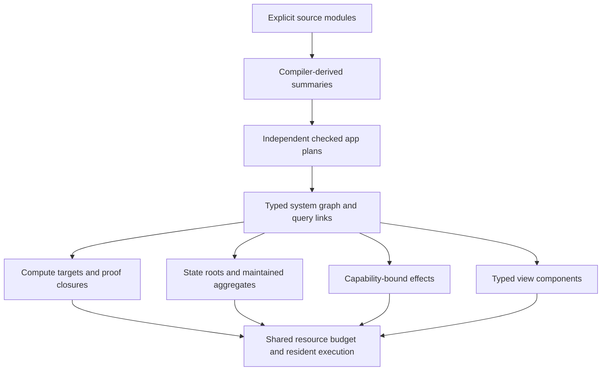

# Connected Ink systems and checked module summaries

A system builds application units independently, reuses unchanged checked releases, and connects exported readonly queries to typed view inputs. Each app keeps its own state, release fence, worker and journal. The system graph binds the complete admitted implementations and their connections.



[Two-app example](../examples/tables-system) · [Measured run](benchmarks/tables-system-2026-11-04.json)

## Checked summaries

Every newly built implementation includes `ink-module-summaries-v1` in its private implementation artifact. The compiler's `describeModules` operation parses the explicit graph, runs ordinary whole-module checks, and reports declaration ownership and generic templates. Host code does not infer ownership from source text patterns.

Summaries bind the compiler, exact source bytes, transitive dependency identities, exported type descriptors, reachable nominal type context, checked entry dependencies and preconditions. Pure-library and checked-entry-effect guarantees describe facts the existing checker establishes. Generic templates are identified explicitly: their instances are checked when elaborated; there is no claim that unused template bodies have a universal proof.

A library's identity excludes unrelated modules. Editing a library changes its identity and those of its callers. Unrelated library identities remain reusable. Changing a source comment still changes source provenance, even when executable core is unchanged. Release admission re-derives every supplied summary from checked source and rejects edits to it.

Summaries grant no rewrite, commutation, layout, profitability or migration authority. Applicable implementations still carry ordinary complete proof closures and exact generated target hashes. The system graph contains per-unit compute targets, state roots, view components, effect protocols and typed query connections. It is a composition/admission graph, not a new proof rule.

## Separate compilation and build reuse

`ink system-build DIRECTORY` reads an explicit `ink-system.json` and each declared app manifest. It compiles each app as its own unit, then checks connections. Version 1 permits 1–16 units and 128 links in a bounded system packet. The existing 64-source / 128 KiB combined source bound remains **per app**. This permits larger systems without raising source limits or merging every app into one stateful root.

Within an app, pure libraries still use the existing linked module graph. This release does not add separately linked native object files, arbitrary stateful imported libraries, recursive service graphs, or global optimization across a mutable process boundary. A future planner can expand a selected boundary, but must reconstruct the checked source and replay proofs preserving observable replies, versions, errors and events.

Unchanged baseline and explicitly replayed units can reuse a private content-addressed disk cache. Keys bind compiler, builder/host assets, manifests and exact source/proof inputs. Cache admission verifies requested source and contracts, replays the implementation and checks its summaries and target bytes. Frontend assets, metadata and commands are reconstructed from the requested manifest, even on a cache hit. Corrupt or mismatched cache entries become misses. Search/auto units are rebuilt, so historical measurements cannot silently authorize an automatic choice under a different workload or machine. The cache retains at most 32 files / 128 MiB; failures to maintain it do not prevent a fresh checked build.

Immutable compiler outputs are cached at eight entries / 32 MiB. Proof replay results are bounded to sixteen entries / 64 MiB. A runtime admission cache retains at most sixteen app releases / 64 MiB and checks the current app/release record on every request. It stores already verified immutable bytes, so normal requests do not reload, parse or hash the proof packet. The identity of a sealed source packet is also reused. A new runtime/code instance or changed release digest requires admission again. These are encoded-size bounds, separate from worker reservations and total process RSS.

The original complete fold proof is larger than the old 6 MiB OS planning packet limit. Its authoring tool shares repeated self-contained certificates through ordinary theorem uses, then replays the complete result. The demonstration now uses [reusable checked proof units](proof-units.md), reducing its 8.38 MB complete plan to 2.96 MB while preserving cold replay and source-specific checks. The OS plan bound is 12 MiB; compiler transport is 16 MiB request / 32 MiB response. Source, generated JavaScript, output, checkpoint and UI limits retain their independent bounds. Large proof compilation reserves 1 GiB in the shared execution budget; insufficient configured capacity rejects admission. The Wasm compiler has a 512 MiB maximum memory. Proof bytes remain build/admission work, not per-request work.

The compiler metadata records transport revisions eligible for replay. That permits trying an older release with the same pinned dependencies; it never admits it on the metadata alone. Full current proof replay and byte-for-byte target/manifest/evidence comparison remain mandatory. Unknown compilers and altered outputs reject.

## Typed query connections

An unbound consumer component declares `"data": true` and takes `UiData<Row>`. Such a template cannot be installed directly. A system link chooses a provider, exported readonly entry, exact argument JSON and consumer component. Linking checks that the provider's complete result type equals the component input type and validates arguments with the provider's checked codec. Changes, host bindings, effect protocols, undeclared exports, wrong types, duplicate ports, missing ports and dependency cycles reject.

Deployment replaces each port with:

```json
{"read":{"appId":"PROVIDER_ID","releaseId":"EXACT_RELEASE_ID","entry":"dashboard","input":"[0,20]"}}
```

Foreign reads require the consumer's declared `apps.invoke`; provider execution requires `code.execute`. A provider's own UI can use `appId` and `releaseId` both set to `self`. The broker shares snapshots only for identical provider/release/arguments/type bindings. Replies retain exact Ink values and source versions. Reads are taken outside the consumer state lock, avoiding reciprocal lock ownership; declared reads are prefetched conservatively. They are readonly operations, not external HTTP requests or permission to reorder writes.

Authoritative collaboration commits invalidate snapshots immediately; asynchronous World projection does not delay an update. Standalone World-backed state headers remain supported. Release records fence changed providers. A snapshot stays current until a commit writes a state root the exported query reads, using the compiler's IR write roots; finer field or row ranges are not tracked. Ordinary component dependencies and keyed patches still apply. Desktop frames refresh for another app's commit only when the host lists them as readers of a changed root (`ink-reads`); they do not receive private provider state bodies. Links may also carry a checked plan that runs the consumer's pure filter, page and aggregate next to a read-only copy of the provider ([cross-app plans](cross-app-plans.md)). A provider release change fences its consumers until they are rebuilt with an explicit new binding. The broker does not silently retarget a pinned query.

## Deployment and recovery

`ink system-deploy DIRECTORY` requires a clean, committed system source tree. The owner API provides `POST /api/v1/ink/systems/build` and `POST /api/v1/ink/systems/deploy` with `{input: ...}`. Scoped keys require `apps:deploy`; the server SDK exposes `client.ink.systems.build/deploy`.

All units and links are checked before app publication starts. Providers publish before consumers. A durable rollout receipt records app/release identities so an interrupted recorded publication can resume and an identical retry returns the same apps. Existing unrelated slugs, changed active releases and invalid receipts reject. This is a staged rollout, **not an atomic multi-app deployment**. Failure before an app registration is recorded can leave an orphan registration requiring explicit reconciliation. Upgrading an already installed system to a different graph is not an automatic migration; version 1's deploy command installs/resumes the exact graph. Existing app migration and release APIs remain the route for deliberate upgrades.

## Demonstration and measurement

Tables defines typed rows, optimistic version guards, events, aborts, filtered sum/count keeps and paginated exported reads in Ink. A selected maintained-fold plan incrementally maintains both keeps. Its own view and a second app's view consume the same pinned exported query. Both refresh with keyed patches; form state remains local. The native test runs identical histories through JavaScript and actual Rust, then restarts services, recovers the journal, checks a duplicate reply and reopens the consumer view.

`node scripts/benchmark-ink-system.mjs` runs a fresh Node/browser process for each of baseline JavaScript, selected JavaScript and selected native computation. Set `INK_UI_BROWSER_EXECUTABLE` to an existing Chrome/Chromium and configure Rust for the native run. It measures HTTP write → durable commit → event stream → query → two DOM updates → animation frame, plus concurrent version conflicts, journal bytes, RPC body bytes, memory, mounting and service recovery. The native processes actually restart during recovery, and collaboration replays committed records beyond its checkpoint. The Node coordinator's compiler caches survive that **in-process service restart**, so it is not a cold whole-host recovery measurement.

The benchmark uses a loopback owner fixture; production authentication, desktop MessagePort transport and the Electron window compositor are outside its scope. Lost-reply coverage deliberately discards a completed application reply before retrying its request identity. The report states what its byte and memory counters include. It uses 64 seed rows, 16 measured edits, 20-row pages and 16 concurrent guarded writes. It separately measures conflict replies and sixteen successful HTTP writes with optimistic retries. These are exploratory single-host measurements, not a universal speedup or profitability proof. Pagination currently filters/materializes Ink table values before slicing; large-table indexed query placement remains a useful next boundary to optimize. No arbitrary query join, cross-app write fusion, GPU placement or native-widget lowering is implied by this demonstration.

The recorded Apple M4 Pro run produced:

| Computation | Edit-to-observed-frame p50 / p95 | Successful guarded commits/s | Service recovery |
| --- | ---: | ---: | ---: |
| Baseline JavaScript | 66.1 / 82.9 ms | 49.3 | 84.9 ms |
| Selected JavaScript | 66.1 / 82.7 ms | 49.6 | 155.7 ms |
| Selected native | 82.2 / 99.0 ms | 45.1 | 94.6 ms |

All modes persisted about 4.8 KiB and exchanged about 14.0 KiB of RPC bodies per measured edit. At this small workload, maintained computation does not improve complete latency; durable commit, invalidation coalescing, frame cadence and optimistic retry contention remain substantial costs. Selected plans also increase admission memory and build time. These results establish the connected execution and recovery path, while leaving large-table placement and proof/admission memory as measurable next improvements.

[Full timing and byte profile](benchmarks/tables-profile-2026-11-04.md) separates DOM completion from the frame proxy, accounts for the repeated entry descriptors, and measures larger tables and periodic checkpoint replacement.

[Retained exported queries](retained-queries.md) keep one live result across both apps and deliver versioned, replayable view patches. The existing source example activates this path through the current host and UI runtime.

The follow-up [proof admission study](proof-units.md) compares complete replay with independently checked mathematical units, including fresh-process memory and changed-view admissions. Existing historical measurements above retain their original proof format and compiler bindings.
